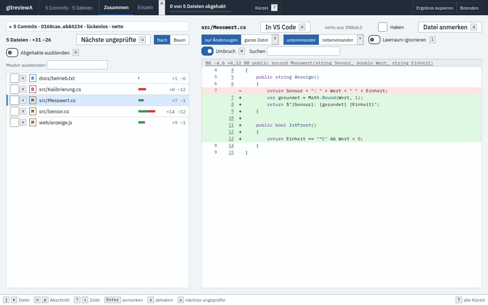
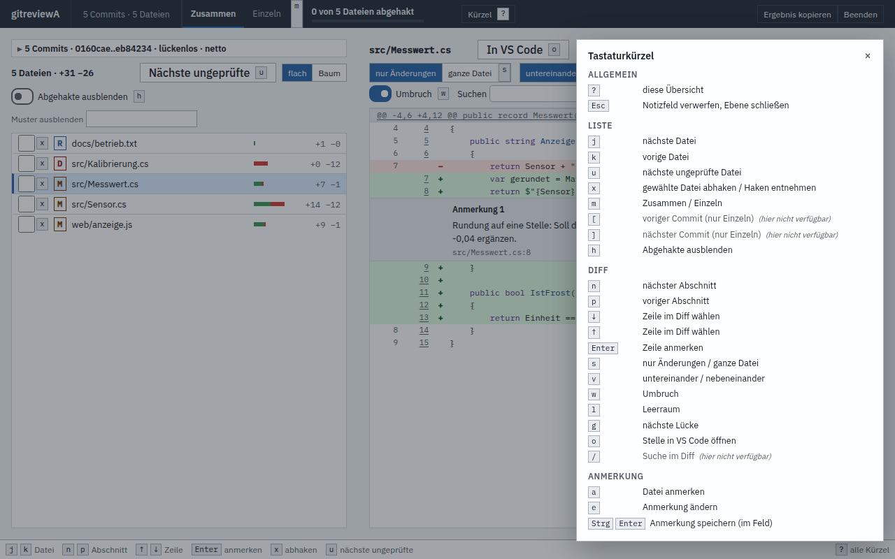
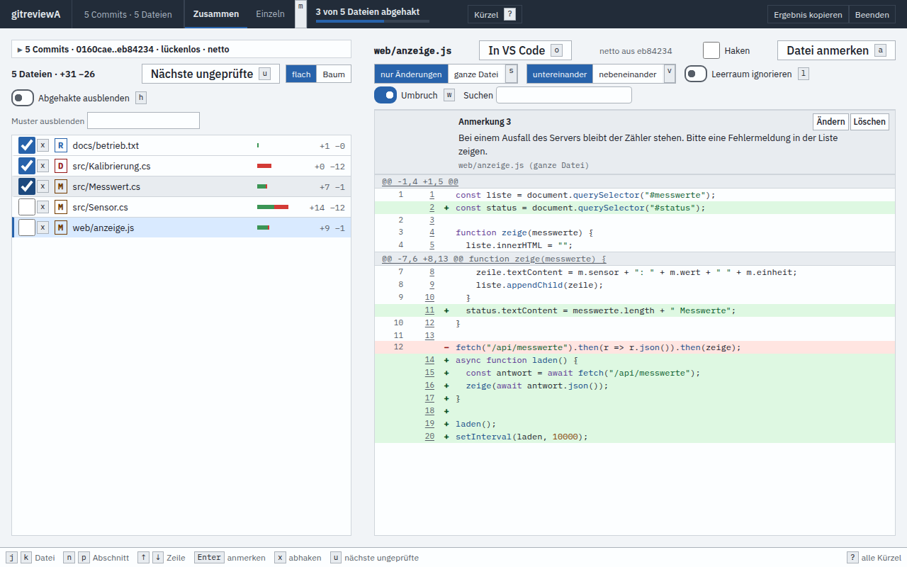
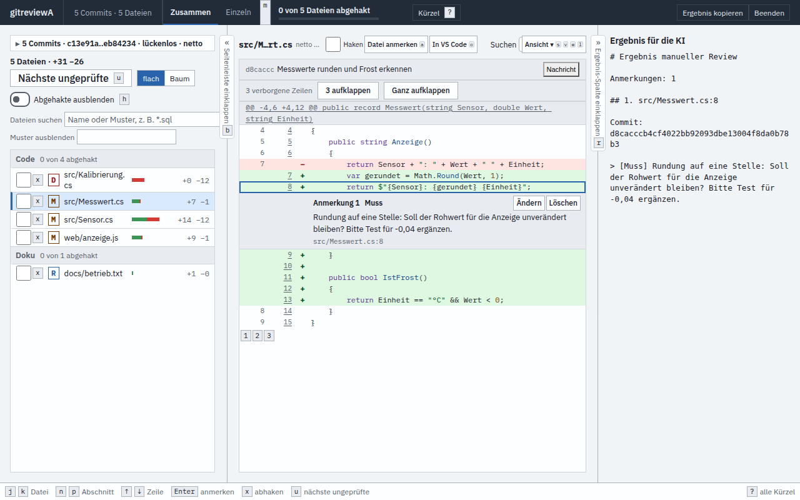
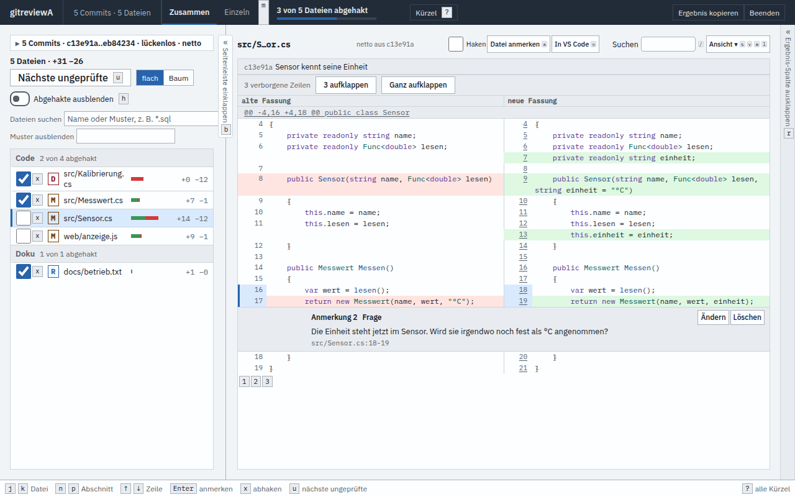

# gitreviewA

gitreviewA ist ein Kommandozeilenwerkzeug für Reviews von Git-Commits: Sie rufen es in einem Repository mit einer Auswahl von Commits auf, sehen die Änderungen in einer schlichten Weboberfläche durch, haken geprüfte Dateien ab und hängen Anmerkungen an Stellen im Diff. Mit **Beenden** gibt es das „Ergebnis manueller Review“ auf stdout aus — an Sie im Terminal oder an die KI, die das Werkzeug aufgerufen hat und auf Ihr Urteil wartet.

Lizenz: MIT.



Die Bilder in dieser Datei zeigen ein erfundenes Beispiel-Repository „Wetterstation“ ([so entstehen sie](Dokumentation/Bilder/readme/ERZEUGEN.md)).

## Inhalt

1. [Wozu](#wozu)
2. [Installation](#installation)
3. [Erste Review in zwei Minuten](#erste-review-in-zwei-minuten)
4. [Die Oberfläche](#die-oberfläche)
5. [Für KI und Automatisierung: der Aufrufvertrag](#für-ki-und-automatisierung-der-aufrufvertrag)
6. [Grenzen](#grenzen)
7. [Für Mitentwickler](#für-mitentwickler)
8. [Lizenz und Herkunft](#lizenz-und-herkunft)

## Wozu

KI-Agenten schreiben Commits schneller, als ein Mensch sie in `git log -p` oder einer IDE sinnvoll durchsehen kann. Ein Pull-Request-Werkzeug passt oft nicht, weil direkt auf `main` gearbeitet wird und nicht jede Prüfung einen Pull Request rechtfertigt. gitreviewA füllt die Lücke: Sie wählen genau die Commits, um die es geht, prüfen sie mit Checkliste und Anmerkungen, und Ihr Urteil geht ohne Abtippen als Text an die KI zurück. Das Ergebnis steht auf der Standardausgabe des Prozesses, also dort, wo die KI ohnehin liest.

## Installation

**Voraussetzungen**: `git` im Suchpfad und die **.NET-10-Runtime (ASP.NET Core)**. Die Datei von gitreviewA bringt die Runtime nicht mit. Prüfen Sie sie mit:

```bash
dotnet --list-runtimes
```

In der Ausgabe muss eine Zeile `Microsoft.AspNetCore.App 10.…` stehen.

**Datei laden**: Das [neueste Release auf GitHub](https://github.com/stho32/gitreviewA/releases/latest) enthält je Plattform genau eine Datei, benannt `gitreviewA-<tag>-<plattform>` (Windows: mit `.exe`), und `SHA256SUMS.txt`:

| Plattform | Dateiname |
|---|---|
| Linux x64 | `gitreviewA-<tag>-linux-x64` |
| Linux ARM64 | `gitreviewA-<tag>-linux-arm64` |
| macOS ARM64 | `gitreviewA-<tag>-osx-arm64` |
| macOS x64 | `gitreviewA-<tag>-osx-x64` |
| Windows x64 | `gitreviewA-<tag>-win-x64.exe` |

Beispiel für Linux x64 mit der GitHub-Kommandozeile `gh`:

```bash
gh release download --repo stho32/gitreviewA --pattern 'gitreviewA-*-linux-x64' --pattern 'SHA256SUMS.txt'
sha256sum --check --ignore-missing SHA256SUMS.txt
chmod +x gitreviewA-*-linux-x64
mv gitreviewA-*-linux-x64 ~/.local/bin/gitreviewA
```

Die Prüfsumme muss mit `gitreviewA-<tag>-linux-x64: OK` bestätigt sein. `~/.local/bin` ist ein Beispiel für einen Ordner im Suchpfad. Danach startet `gitreviewA` aus jedem Ordner.

**Hinweise**

- **macOS**: Die Datei ist weder signiert noch notarisiert; Gatekeeper warnt beim ersten Start.
- **Stand der Prüfung**: Der Release-Lauf baut alle fünf Plattformen. Von Hand geprüft ist nur Linux x64; die übrigen Dateien sind gebaut, nicht von Hand geprüft.
- **Aus dem Quelltext** bauen Sie die Datei selbst: siehe [Für Mitentwickler](#für-mitentwickler).

## Erste Review in zwei Minuten

1. Im Arbeitsbaum des Repositories `gitreviewA HEAD~5..HEAD` eingeben (die fünf neuesten Commits des Beispiels). Das Terminal zeigt eine Zeile mit der Adresse (`… INFO [Start] gitreviewA läuft auf http://127.0.0.1:<Port>/`), und der Browser öffnet die Oberfläche.
2. Links eine Datei wählen, zum Beispiel `src/Messwert.cs`. Rechts erscheint ihr Diff über alle gewählten Commits.
3. Eine geänderte Zeile anklicken, die Anmerkung eintippen und **Speichern** wählen.
4. Das Kästchen vor einer Datei in der Liste setzen, um sie abzuhaken. Der Kopf zeigt zum Beispiel **3 von 5 Dateien abgehakt**.
5. **Beenden** wählen. Die Seite zeigt **Review beendet**, der Prozess endet mit Exit-Code 0, und im Terminal steht das Ergebnis (unverändert aus dem Lauf der Bilder):

```markdown
# Ergebnis manueller Review

Anmerkungen: 3

## 1. src/Messwert.cs:8

Commit: 3f8bdc2391cfb2b0fb392c7c1aad546c4dfe2e4a

> Rundung auf eine Stelle: Soll der Rohwert für die Anzeige unverändert bleiben? Bitte Test für -0,04 ergänzen.

## 2. src/Sensor.cs:18-19

Commit: 0160cae50b3f566f5af420b64273c53236d6e7bf

    18: 		var wert = lesen();
    19: 		return new Messwert(name, wert, einheit);

> Die Einheit steht jetzt im Sensor. Wird sie irgendwo noch fest als °C angenommen?

## 3. web/anzeige.js (ganze Datei)

Commit: eb842340d24c9640344f659ba231ddf999a2fde0

> Bei einem Ausfall des Servers bleibt der Zähler stehen. Bitte eine Fehlermeldung in der Liste zeigen.

## Dateien

Abgehakt: 3 von 5

- src/Kalibrierung.cs (Commit 27d6ef5ebafd4abb5baac521ef8f1d985f3dbf72)
- docs/betrieb.txt (Commit 2c56ed5a78b23ead8c29e96b88e1c3a3a39e9926)
- src/Messwert.cs (Commit 3f8bdc2391cfb2b0fb392c7c1aad546c4dfe2e4a)

Ungeprüft: 2 von 5

- src/Sensor.cs (Commit 0160cae50b3f566f5af420b64273c53236d6e7bf)
- web/anzeige.js (Commit eb842340d24c9640344f659ba231ddf999a2fde0)
```

## Die Oberfläche

Die Oberfläche läuft im Browser unter `127.0.0.1`. Nach dem Start steht **Zusammen** im Kopf gewählt: links die Dateien der ganzen Auswahl, rechts der Diff der gewählten Datei, die Commits als zugeklappte Zeile darüber. Alle Kürzel zeigt **Kürzel** im Kopf oder die Taste `?` (die Liste im Programm ist die Referenz; hier steht sie nicht noch einmal).



**Datei wählen und Diff lesen**: Datei in der Liste anklicken (Tasten `j` und `k`). **flach** und **Baum** schalten die Dateiliste um. Die Diffs entsprechen denen von `git`; Syntaxfarben erscheinen bei bekannten Sprachen.



**Dateien abhaken und den Fortschritt sehen**: Kästchen in der Zeile (Taste `x`). Der Kopf zeigt **n von m Dateien abgehakt**. **Nächste ungeprüfte** (Taste `u`) springt zur nächsten Datei ohne Haken, **Abgehakte ausblenden** (Taste `h`) räumt die Liste auf.



**Eine Zeile anmerken**: Zeile anklicken, Text eintippen, **Speichern** (oder Strg+Enter). Esc verwirft das Feld. Die Anmerkung steht danach unter der Zeile, mit **Ändern** und **Löschen**; **Löschen** fragt nicht nach.

**Einen Zeilenbereich anmerken**: erste Zeile anklicken, mit gedrückter Umschalttaste die zweite Zeile desselben Abschnitts anklicken. Die markierten Zeilen sind hervorgehoben, die Anmerkung steht unter der letzten.

**Eine ganze Datei anmerken**: **Datei anmerken** (Taste `a`).

**Anordnung und Darstellung wählen**: **untereinander** oder **nebeneinander** (alte Fassung links, neue rechts), **nur Änderungen** oder **ganze Datei**, **Umbruch** (beim Start an) und **Leerraum ignorieren**.



**Lücken aufklappen**: In **Einzeln** und in **Zusammen** zeigt der Diff vor dem ersten, zwischen zwei und nach dem letzten Abschnitt **n verborgene Zeilen** mit den Schaltflächen **20 aufklappen** und **Ganz aufklappen**.

**Im Diff suchen**: Text in **Suchen** eintippen und Enter drücken. Die Treffer sind hervorgehoben, ein Zähler nennt ihre Zahl, zum Beispiel **1 von 2**.

**Dateien ausblenden**: In **Muster ausblenden** ein Muster wie `*.lock` eintippen und mit Enter bestätigen; **Entfernen** nimmt es zurück. Der Kopf zeigt, wie viele Dateien ausgeblendet sind. Ausgeblendete Dateien bleiben Teil der Auswahl, zählen im Fortschritt und stehen im Ergebnis. Dieselben Muster setzt der Aufruf mit `--ignore`.

**Commits einzeln durchgehen**: **Einzeln** (Taste `m`) zeigt eine Commit-Liste mit Vor- und Zurück-Schaltflächen (Tasten `[` und `]`). Der Haken gilt dort je Stelle, also je Commit und Datei; der Kopf zählt **Stellen**. **Zusammen** fasst die Commits je Datei zusammen — als Netto-Diff, wo die Commits eine lückenlose Kette bilden (die Commit-Zeile sagt **lückenlos · netto**), sonst je Commit beschriftet.

**In den Editor springen**: **In VS Code** (Taste `o`) oder die Zeilennummer öffnet die Stelle über einen `vscode://`-Link. Liegt die Datei nicht im Arbeitsbaum, steht **Datei liegt nicht im Arbeitsbaum** im Kopf.

**Ergebnis kopieren**: **Ergebnis kopieren** meldet **Ergebnis kopiert**; der Lauf geht weiter.

**Beenden**: **Beenden** schließt den Lauf und gibt das Ergebnis aus.

## Für KI und Automatisierung: der Aufrufvertrag

**Aufruf**

```text
gitreviewA <hash…> | <von>..<bis>… | - [--port <n>] [--kein-browser] [--ignore <muster>] [--verbose] [--quiet]
```

- **Hashes**: ein oder mehrere Commit-Hashes (4 bis 64 Hexziffern, Kurzhashes gehen). Ein Name wie `HEAD` allein ist kein Hash; `HEAD~5..HEAD` ist ein Bereich.
- **Bereiche**: `<von>..<bis>`, mehrere sind möglich. Hashes und Bereiche lassen sich nicht mischen.
- **stdin**: `-` liest Hashes von stdin, ein Hash je Zeile, nur aus einer Pipe: `git rev-list -n 3 HEAD | gitreviewA -`. Ein Terminal oder eine Pipe, die nach 10 Sekunden nicht endet, ist ein ungültiger Aufruf.
- **Auswahl**: ab 201 Commits warnt gitreviewA auf stderr, über 1 000 Commits lehnt es den Aufruf ab (Exit 2).
- Der Aufruf gilt für das Repository des Arbeitsordners; der Arbeitsordner braucht einen Arbeitsbaum.

**Optionen**

| Option | Wirkung |
|---|---|
| `--port <n>` | Port auf `127.0.0.1`; ohne Angabe wählt gitreviewA einen freien |
| `--kein-browser` | öffnet den Browser nicht; die Adresse steht auf stderr |
| `--ignore <muster>` | blendet Dateien aus der Dateiliste aus, mehrfach angebbar (höchstens 20 Muster zu je höchstens 200 Zeichen); `*`, `**`, `?` und `[abc]` |
| `--verbose` | stderr zeigt auch Debug-Zeilen |
| `--quiet` | stderr zeigt nur Fehler — auch die Zeile mit der Adresse fehlt dann |

`--verbose` und `--quiet` schließen sich aus.

**Ströme**: **stdout gehört allein dem Ergebnis** und bleibt bis **Beenden** leer. Alle Meldungen stehen auf stderr, je Zeile `Zeit STUFE [Kontext] Text`. Ohne Option erscheinen Warnungen, Fehler und die Zeile mit der Adresse:

```text
2026-11-25T21:44:49.087+01:00 INFO [Start] gitreviewA läuft auf http://127.0.0.1:60639/
```

**Exit-Codes**

| Code | Anlass | stdout | stderr |
|---|---|---|---|
| 0 | der Mensch hat **Beenden** gewählt | das Ergebnis | Adresse (und Meldungen) |
| 2 | ungültiger Aufruf: unbekannter Hash, leere Auswahl, kein Repository, ungültige Option, stdin ist ein Terminal | leer | `FEHLER [Aufruf] …` mit dem Grund und dem Ausweg |
| 130 | Abbruch durch Strg+C, `SIGINT` oder `SIGTERM` | leer | `WARNUNG [Abbruch] Review abgebrochen` |
| 1 | Fehler nach dem Start, zum Beispiel der Port ist belegt | leer | `FEHLER [Server] Server ließ sich nicht starten: …` |

**Ablauf**: Der Prozess wartet, bis der Mensch **Beenden** wählt. Ein Zeitlimit gibt es nicht. Ein geschlossener Browser-Tab beendet nichts; der Lauf geht weiter, bis **Beenden** oder ein Abbruch kommt. Ein Abbruch lässt Haken und Anmerkungen verfallen: kein Ergebnis, Exit 130.

**Ergebnisformat**: Markdown, UTF-8, Zeilenende LF, nur auf stdout. Das Beispiel oben zeigt es vollständig.

- Überschrift `# Ergebnis manueller Review`, dann `Anmerkungen: <n>` oder `Keine Anmerkungen.`
- Je Anmerkung ein Abschnitt `## <Nr>. <Stelle>` in der Reihenfolge des Anlegens, mit `Commit: <voller Hash>`; der Text steht als Zitat (`> …`).
- **Stelle** ist `<Datei>:<Zeile>`, bei einem Bereich `<Datei>:<von>-<bis>` (zusätzlich ein Zitat der markierten Zeilen, höchstens 20, danach `… (k weitere Zeilen)`) oder `<Datei> (ganze Datei)`. Die Zeilennummern gelten für die neue Fassung.
- Der Commit nennt den Stand, auf den sich die Anmerkung bezieht, nicht den Urheber. In **Zusammen** ist es der jüngste Commit der Auswahl, der die Datei ändert.
- Ab dem ersten Haken folgt `## Dateien`: `Abgehakt: n von m` und `Ungeprüft: n von m`, je Stelle eine Zeile `- <Datei> (Commit <voller Hash>)`.
- Namen mit unsichtbaren oder richtungsändernden Zeichen erscheinen als Marke wie `⟨U+202E⟩`, Bytes ohne UTF-8-Entsprechung als `⟨0xFF⟩`.
- **Kein Gesamturteil**: „Keine Anmerkungen.“ heißt nicht „freigegeben“, und Exit 0 heißt nicht „gut“. Das Ergebnis besteht aus den Anmerkungen.

**Beispiel aus einem Agenten (Shell)**: Der Aufruf blockiert, bis der Mensch fertig ist. Die Adresse für den Menschen steht in `review.log`.

```bash
ergebnis=$(gitreviewA HEAD~5..HEAD 2>review.log)
status=$?
case $status in
  0)   printf '%s\n' "$ergebnis" ;;           # Anmerkungen lesen und abarbeiten
  2)   cat review.log; exit 2 ;;              # Aufruf korrigieren
  130) echo "Der Mensch hat abgebrochen" ;;   # es gibt kein Urteil
  *)   cat review.log; exit "$status" ;;      # Fehler nach dem Start
esac
```

Das Ergebnis ist Text, kein Bild. Eine KI liest es direkt als Arbeitsauftrag.

## Grenzen

- **Nichts wird gespeichert**: Haken und Anmerkungen leben im Arbeitsspeicher des Laufs. Es gibt kein Fortsetzen und keine gespeicherten Läufe; das Ergebnis existiert nur als Ausgabe.
- **Ein Mensch, ein Tab, nur localhost** (`127.0.0.1`): kein Mehrbenutzerbetrieb, kein Zugriff über das Netz. Ein Abbruch ist nur über Strg+C oder ein Signal möglich.
- **Kein Pull-Request-Ersatz**: keine Kommentare zurück zu GitHub, keine Freigabe-Workflows. **Kein Editor**: gitreviewA ändert keine Dateien und keine Commits.
- **Kein Gesamturteil**: **Beenden** endet immer mit Exit 0; ein zweites Ausgabeformat (JSON) gibt es nicht.
- **Git nur über die `git`-Kommandozeile**; nur Repositories mit Arbeitsbaum (ein nacktes Repository ist ein ungültiger Aufruf).
- **Auswahl bis 1 000 Commits** je Lauf. Das Lastprofil der Vision — flüssig bis 200 Commits, 2 000 Dateien, 20 000 Diff-Zeilen je Datei und 500 Anmerkungen — ist die **Auslegung**, ein Ziel aus [`Anforderungen/R00000-vision.md`](Anforderungen/R00000-vision.md), keine Messung.
- **Plattformen**: gebaut werden die fünf oben genannten; von Hand geprüft ist Linux x64.
- **Frameworkabhängig**: die .NET-10-Runtime (ASP.NET Core) muss installiert sein.
- **macOS**: ohne Signatur und Notarisierung; Gatekeeper warnt.
- **Browser**: Die Oberfläche braucht einen Browser auf demselben Rechner; ohne ihn (`--kein-browser`) ruft ein Mensch die Adresse aus stderr selbst auf.

## Für Mitentwickler

**Voraussetzungen**: .NET-10-SDK, `git`, für die Browser-Tests Node.js mit npm.

**Bauen und testen**

```bash
dotnet build gitreviewA.sln -warnaserror
dotnet test gitreviewA.sln
cd e2e && npm install && npx playwright install chromium && npx playwright test
```

Die Browser-Tests (Playwright, `e2e/`) starten das gebaute Programm aus `src/GitReviewA/bin/Debug/net10.0/gitreviewA.dll`, bauen Sie also zuerst. Mit der Umgebungsvariable `GITREVIEWA_DLL` zeigen Sie auf eine andere `gitreviewA.dll`. Jeder Test legt sein Wegwerf-Repository selbst an und räumt es weg.

**Eine Datei je Plattform erzeugen**

```bash
skripte/veroeffentlichen.sh linux-x64
```

Ohne Argument erzeugt das Skript `linux-x64`, `win-x64` und `osx-arm64`; bekannt sind auch `linux-arm64` und `osx-x64`. Die Dateien liegen unter `veroeffentlicht/<plattform>/` (mit `AUSGABE=<ordner>` anderswo); stdout zeigt nur ihre Pfade.

**Ordner**

| Ordner | Inhalt |
|---|---|
| `src/GitReviewA` | das Programm; ein Ordner je Thema (`Aufruf`, `Git`, `Server`, `Diff`, `Zusammen`, `Anmerkungen`, `Haken`, `Beenden`, `Sprung`, `Protokoll`, `Fremdtext` …) |
| `src/GitReviewA/web` | die eingebettete Weboberfläche (HTML, JavaScript, CSS, Schriften, Prism) |
| `tests/GitReviewA.Tests` | NUnit: Unit- und Integrationstests, `Akzeptanz/` für die Akzeptanzkriterien |
| `e2e` | Playwright-Tests gegen das echte Programm (`tests/`, `treiber/`, `dsl/`) |
| `skripte` | `veroeffentlichen.sh` |
| `Anforderungen` | die Vision `R00000` und die Anforderungen `R00001` ff., dazu `user-stories/` |
| `Dokumentation` | `Planung/` (Arbeitsstrukturplan), `Sicherheit/`, `Wireframes/`, `Bilder/readme/` |
| `AI-Team` | Konfiguration und Entscheidungen des KI-Teams, das gitreviewA baut |

**Release**: Ein Tag `v*` löst `.github/workflows/release.yml` aus. Der Lauf veröffentlicht je Plattform eine Datei, benennt sie `gitreviewA-<tag>-<plattform>` und hängt sie samt `SHA256SUMS.txt` an ein GitHub-Release.

**Planung**: Das Zielbild steht in der Vision, die Anforderungen mit prüfbaren Kriterien in `Anforderungen/`, der Umfang als Arbeitsstrukturplan in `Dokumentation/Planung/gitreviewa.md`. Wie das KI-Team arbeitet und testet (Test zuerst, Browser-Tests nur für die heißen Abläufe), steht in `AI-Team/factory.md`.

## Lizenz und Herkunft

gitreviewA steht unter der MIT-Lizenz.

Mitgelieferte Komponenten mit Lizenztext im Repository:

- **Prism** (MIT, Lea Verou) für die Syntaxfarben: [`src/GitReviewA/web/vendor/LICENSE-prism.txt`](src/GitReviewA/web/vendor/LICENSE-prism.txt)
- **IBM Plex** (SIL Open Font License 1.1) als Schrift: [`src/GitReviewA/web/fonts/LICENSE-OFL.txt`](src/GitReviewA/web/fonts/LICENSE-OFL.txt)

Gestaltung und einzelne Skripte der Oberfläche stammen aus dem Schwesterprojekt kanbanD; die Kopfkommentare der Dateien in `src/GitReviewA/web` nennen die Herkunft.
